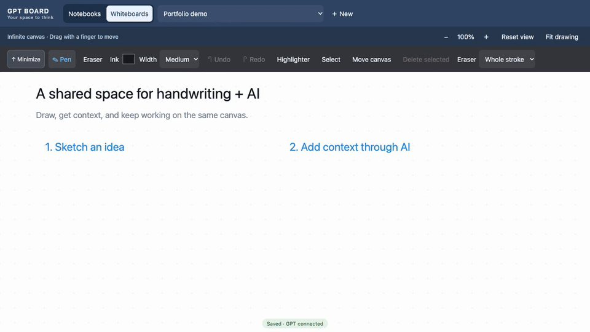

# GPT Board

[](https://github.com/AntonioZannella/gpt-board/actions/workflows/ci.yml)

Handwritten notebooks and whiteboards that an AI assistant can read and annotate. Write on an iPad, follow along on your Mac, and keep your notebook files on your own computer.

Built with a Python backend, plain JavaScript and Canvas 2D. An optional Swift iPad app adds Apple Pencil double-tap and native file sharing. AI access uses Model Context Protocol (MCP); drawing works without an AI account.



*The demo shows the core drawing and annotation workflow; the current toolbar includes additional controls.*

## What it does

- **Write and organize:** paged notebooks, infinite whiteboards, pen/highlighter/eraser, undo, color palette, page duplication, and reversible Trash.
- **Use both devices:** Mac Follow iPad mode, live handwriting previews, trackpad page navigation, and paired local-network access.
- **Work with PDFs:** import pages with internal links, replace backgrounds while preserving handwriting, and export selected pages with annotations.
- **Ask an AI:** capture the current iPad page in one tool call, add editable annotations, inspect proposed edits, and undo AI changes.
- **Keep recoverable work:** revision-checked saves, local recovery journals, conflict preservation, rolling backups, and portable notebook JSON.

The iPad currently requires the Mac server to be running. This is an actively developed personal study tool, not a hosted service or a fully offline iPad app.

## Quick start

Requires Python 3.11 or newer and a browser. From the repository folder:

```sh
python3 -m venv .venv
.venv/bin/python -m pip install -r requirements.txt
.venv/bin/python board.py start
```

On Windows, the virtual-environment interpreter is `.venv\Scripts\python.exe`; Windows behavior has not been certified. Core drawing can also run with `python3 board.py start` without extra packages. The optional dependencies enable PDF/image processing and QR pairing. Node is needed for JavaScript tests, not to run the app.

The launcher builds the frontend and opens [localhost:8787](http://localhost:8787). Leave the terminal running and wait for **Saved** before closing. Use **More** for Files, Library, AI, and Recovery. `python3 board.py doctor` provides redacted diagnostics.

**Upgrading an existing installation?** Preserve `data/`, wait for Saved, stop the existing services, update the source, restart, and reload the clients. See [upgrade and recovery](docs/RECOVERY.md).

## Connect your iPad

Keep both devices on the same trusted Wi-Fi. On the Mac, choose **More → Connect iPad** and use the displayed URL, QR invitation, or pairing code. Invitations expire and work once. You can revoke devices from the Mac.

Use Safari, or build the [optional native iPad app](ios/README.md) in Xcode for Apple Pencil double-tap and native sharing. It is not distributed through the App Store. Signing requirements depend on your Apple development account.

Use **Follow iPad** on the Mac to follow the tablet's current page. Changing between a numeric IP address and a `.local` address changes the browser's storage origin; save before switching addresses.

## PDFs and backups

**More → Files** offers a new-notebook import, append, or explicit background-replacement mapping. Replacement retains page IDs and handwriting and rejects incompatible page proportions. Imported PDF links navigate between pages.

PDF import/export supports up to 500 pages, subject to size limits: 16 MiB PDF/image input, 32 MiB rendered import staging, and 48 MiB per notebook. Large documents may need splitting. Browser JSON import accepts up to 64 MiB before validating the decoded notebook; native Files sharing accepts up to 16 MiB.

Export all pages or a range such as `1-5, 8, 12-14`. PDF output is rasterized; use notebook JSON for an editable backup. [Workflow details](docs/WORKFLOW_UPDATE.md)

## Connect an AI assistant

Configure a compatible **local MCP client** with `http://localhost:8787/mcp/<token>`, using the private token in `data/token`. Never publish that complete URL. Cloud-only clients cannot reach localhost directly; the paired iPad bridge does not expose MCP.

A default `read_board` request captures the active iPad page and returns its identity and fresh evidence. Explicit page requests and page listings are also available. Choose **More → AI** to set an annotation target and review proposals.

AI edits require stable operation IDs. Only AI-owned annotations can be changed automatically; edits to student work require approval of the exact proposal. Imported pages and locked shapes remain protected. Optional review logging connects to an existing configured Math Learning System; that system and personal study records are not included.

## Architecture and privacy

The browser handles drawing locally. Python validates and saves notebook edits, while server-sent events carry updates between connected clients. The native app reuses the same web drawing engine. [Architecture and configuration](docs/DETAILS.md)

Private notebooks, page images, tokens, pairing state, backups, and review evidence live in `data/` and are excluded from Git. Browser recovery belongs to its exact origin. When you ask an AI to read a page, that content goes to the configured AI service under its policies.

The local bridge uses HTTP, so traffic is not encrypted. Use a trusted network; public hosting and untrusted-network access are unsupported. Same-disk backups are not disaster backups. [Security](docs/SECURITY.md) · [Recovery](docs/RECOVERY.md)

## Development and verification

```sh
.venv/bin/python -m pip install -r requirements-dev.txt
.venv/bin/python test.py
```

Tests use disposable notebooks and synthetic course records. The optional external-controller integration is skipped unless explicitly configured. CI runs backend/client tests and Chromium/WebKit workflows. See the badge for hosted status, rather than treating local results as a guarantee.

[Verification record](docs/RELEASE_TESTS.md) · [Performance measurements](docs/PERFORMANCE.md) · [Compatibility](docs/COMPATIBILITY.md) · [Contributing](CONTRIBUTING.md) · [Changelog](CHANGELOG.md)

## Authorship

I design the features and test them, using AI coding tools for implementation. I am learning the Python backend as I maintain it; browser drawing and input stay in JavaScript, and native Apple Pencil integration uses Swift.
