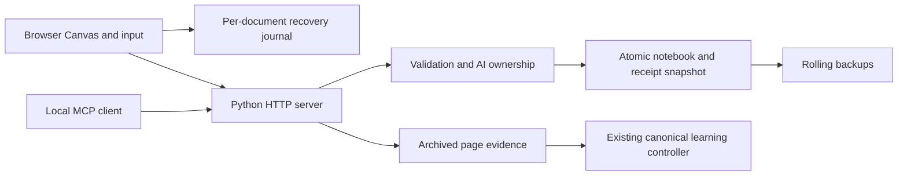

# GPT Board: implementation details

Current local candidate: **1.3.0rc1**. See the exact [60-item mapping](READINESS_CHECKLIST.md), [compatibility](COMPATIBILITY.md), and [recovery](RECOVERY.md).

## Run and build

`python3 board.py start` checks Python, health and frontend freshness before launching. It owns an OS file lock; main server and bridge also own locks, so competing launches cannot start a second writer against one installation. Child startup is probed before success is announced; termination cleans up children. The supervisor checks changed Wi-Fi addresses every 15 seconds. An orphaned bridge exits after three failed five-second upstream checks. A recognized running server is reported, never replaced. `stop` refuses open tabs.

`PORT` changes the loopback port, `IPAD_PORT` the bridge port, and `IPAD_HOST` an explicitly selected local Wi-Fi bind address. Keep distinct installations in distinct directories. The `.js` launchers retain older command compatibility; Python is the implementation. `build.py` copies readable browser source without a JavaScript compilation framework.

## Optional review configuration

Use existing initialized courses. Preserve private configuration during upgrades:

```json
{"review":{"controller":"/path/to/existing/Math Learning System/mls.py",
  "python":"python3","courses":{"Exact course label":"/path/to/initialized/course"},
  "max_evidence_bytes":536870912}}
```

Save as private `data/config.json`. `MLS_CONTROLLER`, `MLS_PYTHON`, and `MLS_COURSES_JSON` can override the adapter settings. No personal course/path is a source default. The canonical controller remains responsible for recording, session/audit rules and the existing shared error log. Never point test fixtures at real course stores.

Each exact-page read archives actual PNG bytes with a SHA-256 hash, capture time, notebook, stable frame ID when returned, revision and optional slice. Recording verifies those bytes. `supersedes` changes an assessment with fresh evidence and a new review; `resolves` links a later successful retry, preserving help. Historical records are never silently pruned. At 512 MiB of evidence (configurable), archiving refuses new evidence and explains the limit. Preserve/export the archive before deliberately adjusting it.

The read-only history panel reads only `kind: board_review` records from the mapped canonical `attempts.jsonl`, with pagination and original correction links. It intentionally does not call the controller's `state`/`export` commands: those rebuild derived state and may append transition records. Due practice remains in the canonical study workflow because the current controller has no read-only due-practice query.

## Architecture



The browser draws immediately. The server validates saves; the notebook file owns committed content. The review adapter delegates recording to the already configured learning system.

| File | Responsibility |
| --- | --- |
| `build.py` | Copy frontend sources to generated `dist/`. |
| `board.py`, `file_lock.py` | Startup/status/stop, maintenance commands, OS-owned process locks. |
| `board_storage.py` | Authoritative snapshots, revisions, rolling backups, index recovery, portable notebook files. |
| `validation.py` | Allowed record/shape kinds, dimensions, nested data, parent graphs, strokes and image boundaries. |
| `server.py`, `http_body.py`, `http_limits.py` | HTTP/MCP/SSE routing, Origin/media checks, body deadlines and bounded connections. |
| `ai_operations.py` | Stable operation receipts, provenance, user proposals, page placement and safe undo. |
| `pairing.py`, `ipad_server.py` | One-use invitations, device sessions/revocation, paired forwarding and bridge lifecycle. |
| `media.py`, `media_worker.py` | Temporary import jobs and bounded native-decoder processes; PDF generation. |
| `board_review.py` | Evidence archive and narrow canonical-controller adapter. |
| `src/model.js`, `src/app.js` | Stroke codec/transforms and browser-local Canvas input/rendering/history. |
| `src/sync.js`, `src/recovery.js` | Three-way merge/status and independent browser journals. |
| `src/pages.js`, `src/panels.js` | Stable page lifecycle and accessible management dialogs. |

Browser input remains JavaScript to avoid network delay in handwriting. PDFium is used through pypdfium2 in separate short-lived Python processes because PDFium is not thread-safe. Pillow decodes PNG/JPEG, ReportLab writes raster PDF, and Segno generates pairing QR images. These established libraries are pinned in requirements files. Core drawing still has no third-party runtime dependency. Reference APIs: [pypdfium2](https://pypdfium2.readthedocs.io/en/stable/python_api.html), [Playwright Python](https://playwright.dev/python/docs/intro), [Segno](https://segno.readthedocs.io/en/stable/).

## Saving and AI protocol

`board.json` is the commit boundary. A save names its base revision; stale writes receive the current shapes and revision for three-way reconciliation. Independent shapes merge. Two different changes to one shape keep the saved server copy and preserve the local candidate separately. This is not character-level or stroke-point collaboration.

The local journal prefix is `gpt-board:journal:v2:`. Each new document has a new tab identity. BroadcastChannel probes keep active tabs from consuming each other's journals. Without that API, recent journals wait 30 seconds before recovery. Removal uses compare-before-delete, so a changed journal is not erased. Unrecognized/damaged browser data is retained. A local-storage write is an acceptance by the browser, not a guarantee against storage eviction or power failure. The interrupted portion of a currently unfinished stroke is outside the completed-edit guarantee.

AI mutation receipts are in the same atomic snapshot as their shapes. Caller operation IDs bind to a request hash. Lost responses, browser restarts and server restarts do not reapply an operation with the same ID/payload. A proposal to edit non-AI material binds to the exact store hash and expires after ten minutes. A UI approval that finds changed content refuses and asks for a fresh proposal. Page/image/locked-shape edits remain forbidden. Undo compares post-operation records before restoring old records; it refuses if somebody subsequently changed them. Restore carries current receipt history forward as `reverted_by_restore` to prevent old retries resurrecting content.

Reads still need a connected rendering tab. Stable page IDs or unique names are accepted; duplicate names fail. A deliberately selected target that disconnects is refused. Without selection or explicit notebook, legacy read routing retains the last notebook and never falls back to a different one. Editing requires explicit notebook/frame or a UI-selected target. Read acknowledgements retry without blocking later requests. They cannot roll back saved AI edits because mutation no longer depends on browser acknowledgement.

## Interaction and practical limits

Single-page notebooks retain pressure-aware ink, finger pan/pinch, partial erasing, page swipes, reduced motion and remembered notebook/page/view. Shape/page IDs survive rename and reorder; duplication remaps descendants. Trash marks frame metadata without deleting its records/assets. Notebook archive/trash changes only index metadata. Historical review evidence is unchanged by all of these operations.

Import stages at most two jobs for one hour, with 16 MiB input, 25 PDF pages, bounded native workers and a 32 MiB rendered-job limit. No notebook is changed until commit. Cancellation before commit discards staging; an in-progress decoder may take up to its 30-second process deadline to exit. Once commit has succeeded, cancellation is not a rollback—use page Trash or a backup. Image imports become embedded PNG assets. Notebook files preserve internal IDs but receive a new notebook ID; imported AI ownership and operation receipts are not trusted.

PDF export renders pages sequentially, up to 50 pages and 48 MiB output. The longest side is 2400 pixels (PNG download: 3000); the page aspect ratio is preserved. The same annotation layout wraps long words, fits type to the box, and uses an ellipsis at the minimum size if necessary; the full stored text remains in the readable panel. Raster quality depends on original imported images and ink size. Printing, font appearance and physical paper output still need user inspection. JSON export is the complete portable notebook option when PDF limits are reached.

## Tests and support matrix

See [COMPATIBILITY.md](COMPATIBILITY.md) for actual platform evidence. `test.py` runs Python tests and Node contracts; `tests/browser_smoke.py` orchestrates an isolated source installation and Chromium/WebKit. Screenshots, trace, synthetic video, downloads and logs go to `browser-artifacts/`. CI uploads them even on failure. No test uses personal notebooks or course logs.

`MLS_TEST_CONTROLLER=/path/to/mls.py .venv/bin/python test.py` enables the real-controller fixture. Without that variable, exactly one external-controller test skips. The self-contained correction-chain oracle has a test-only sentinel and is not a replacement learning ledger.

## Code to study and bounded personal improvements

1. Read `build.py`, then trace a saved stroke through `save_changes` in `board_storage.py`. Explain why a revision mismatch returns before writing.
2. Trace `AIOperations.execute`: stable identity, provenance, proposal binding, one-file commit, retry. Explain why an HTTP response can be lost after the save succeeded.
3. Follow a fresh image through `ReviewService.archive`, `payload` and `record`; explain why a returned receipt matters.

Small contributions Antonio can choose and explain: add an accessible keyboard shortcut for opening Files; add a new malformed-stroke regression with a before/after explanation; improve one recovery message after a real Pencil test. These are candidates, not claims that Antonio already implemented them.

## Project history

The public repository began with a snapshot on November 5, 2026, after earlier personal development. Earlier test counts and historical 1.2.0 activation notes describe those earlier stages. Current changes remain uncommitted. Do not roll back notebook data when rolling back code.
